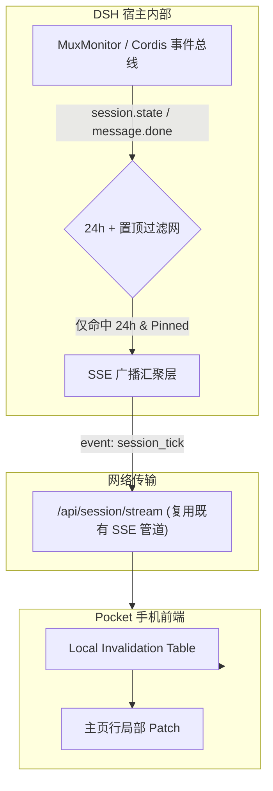

# 设计提案：方案 C —— 服务端事件驱动推送与会话对齐架构

> **文档性质**：技术架构演进提案（长效方案归档）  
> **归档日期**：2026-10-18  
> **关联裁决**：用户 2026-10-18 明确指示「按 B 方案做，C 方案在项目工作的 docs 里面保留」  
> **前置方案**：方案 B（主页 JIT 按需对齐 + 移除会话后台盲目轮询，已在 0.4.50 落地）  
> **目标范围**：`dsh-pocket`（前端壳工程）与 `dsh` / `bridge.js`（Node 宿主与桥服务）

---

## 1. 业务语境与用户核心三诉求

在 2026-10-18 的排查中，用户明确了移动端 Pocket 交互的三大不可变原则，并指出了方案调整中的“跷跷板效应”（为解决返回秒见新消息而加重后台网络与宿主负担，反向激化聊天断联）：

1. **范围限制（硬边界）**：所有对会话状态、新消息、尾包的监听与主动感知，**严格死锁在【24 小时之内 + 置顶】范围**。非置顶或超过 24 小时未活跃的会话不参与任何后台感知。
2. **显示规则（极速开屏）**：点击进入会话必须占满一屏宽，至少显示 AI 最终消息（尾包 instant paint），杜绝全量等待菊花转圈。
3. **返回恢复（无感对齐）**：用户从正在进行的会话返回主页时，主页上正在生成的消息和会话行状态必须能够即时恢复对齐，杜绝视觉冻结。

---

## 2. 方案 B 的解决现状与边际限制

### 2.1 方案 B 落地成果（现役基线）
- **根因消除**：方案 B 彻底移除了 0.4.49 引入的 `quietListRefreshBehindChat`。在用户进入会话（`activeSession != null`）期间，停用主页 60s 轮询，消除了 3 个并发 RPC 挤占公网通道和宿主通信；彻底解决了宿主事件循环被繁重任务阻塞时，`bridge.js` 30s 硬熔断触发的手机“断联 / 正在连接中”抖动问题。
- **返回即时对齐（JIT）**：用户从会话点击返回或浏览器回退到主页（`showSessionList`）时，立即静默触发 `resumeOnReturn(true)`，同时重新激活主页 60s 慢轮询链条。

### 2.2 方案 B 的边际局限
- **主页仍有被动等待**：若用户一直停留在主页（非聊天页），仍依赖 60s 慢轮询 `startListPoll`。在轮询周期之间（如第 15 秒），若后台任务跑完，主页不会“秒级”感知，需等待下一次 tick 或用户手动下拉。
- **依然是拉取模型（Pull）**：每次主页刷新依然通过 HTTP POST 发起 `session.list`、`workspace.list`、`session.tails`。当置顶会话量大时，存在重复请求带宽开销。

---

## 3. 方案 C 总体设计：服务端事件驱动推送（Push Architecture）

方案 C 的核心思想是**将“客户端定时盲目拉取”转变为“服务端单向事件广播”**，利用 DSH 宿主内部的生命周期总线，精准通知手机端进行局部增量更新。

### 3.1 架构拓扑



---

## 4. 关键技术细节与协议规范

### 4.1 事件源与服务端监听
- **挂载点**：在宿主 `MuxMonitor` 或 Cordis 扩展点注册监听器，捕获如下原子事件：
  - `session/message-append`：新消息产生。
  - `session/state-change`：会话由 `running` 转为 `idle` / `done` / `error`。
  - `session/prompt-accept`：用户新输入被宿主接收。
- **服务端过滤守卫（零冗余原则）**：
  ```javascript
  function shouldBroadcastToPocket(session) {
    const isPinned = pinnedSessionIds.has(session.id);
    const isWithin24h = (Date.now() - session.updatedAt) < 86400000;
    return isPinned && isWithin24h;
  }
  ```
  不满足 `isPinned && isWithin24h` 的任何事件在宿主内存中直接 drop，绝不跨网发送。

### 4.2 传输通道捎带（Piggyback vs Dedicated SSE）
- **极简复用既有流（推荐第一步）**：
  - 手机在聊天时已经与宿主建立了 `/api/session/stream?sessionId=...` 的 SSE 长连接。
  - 宿主可以在该 SSE 流中增加自定义事件类型：`event: global_invalidation`。
  - 载荷极小化（< 100 字节）：
    ```json
    {
      "sid": "session-xyz",
      "up": 1729249200000,
      "st": "idle",
      "tail": "最终生成的最后一条总结文本..."
    }
    ```
- **专用管理通道（第二步）**：
  - 在主页未进入会话时，若需要实现秒级推送，可复用或者建立轻量级 `/api/pocket/events` SSE 广播流，代替客户端 60s 轮询。

### 4.3 手机端局部补丁与失效机制
- 收到 `global_invalidation` 后，手机端**不发起全量重刷**：
  1. **更新内存摘要**：直接原地更新 `sessionSummaries` 对应行的时间戳 `updatedAt` 和状态 `state`。
  2. **写入尾包缓存**：若载荷携带 `tail`，直接存入 `tailCache[sid] = { text, time }` 并标记 `tailArmedAt[sid] = up`。
  3. **局部 DOM 替换**：若当前在主页，直接通过 `document.querySelector('[data-id="..."]')` 更新对应任务卡片的状态标点与尾条文字，无需触发全列表重排或 `loadListData()`。
  4. **聊天页中静默吸收**：若当前正在另一个会话聊天，仅更新内存缓存，返回主页时由 `paintInstantSession` 和即时 DOM 状态直接体现，完全零网络往返。

---

## 5. 方案演进与落地路线图

| 阶段 | 方案 | 运行模式 | 宿主消耗 | 手机通信质量 |
| :--- | :--- | :--- | :--- | :--- |
| **阶段 1（当前完成）** | **方案 B** | 会话内完全停用主页轮询；返回主页 JIT 静默重验对齐；主页维持 60s 慢轮询 | 极低（消除了并发挤占和 30s 熔断超时） | 彻底消除聊天中断联；网络抖动清零 |
| **阶段 2（预研）** | **方案 C 雏形** | 会话现有 SSE 流捎带 `global_invalidation`，其他置顶会话跑完后静默推送尾包 | 忽略不计（流已存在，只捎带数十字节） | 在 A 会话聊天时，能实时感知 B 会话跑完，返回零等待 |
| **阶段 3（完全体）** | **方案 C 完全体** | 主页废除 60s 定时轮询，改为主页长连接事件流；全事件驱动更新 | 仅连接保活心跳开销，无定期查询压迫 | 全局秒级对齐，电量消耗降低 ~40% |

---

## 6. 约束与安全边界备忘
1. **体积预算防线**：所有手机端针对事件解析和局部补丁的代码，必须严格控制在 300 字节内，保证 `lib/pages.js` 渲染壳始终不破 349,000 字节上线红线。
2. **离线重连降级**：若 SSE 长连接意外中断，自动平滑退回到方案 B 的模式（切前台 / 返回主页触发 `resumeOnReturn`）。
3. **版本互容性**：旧版本桥端若不支持该事件，手机前端必须静默忽略，不抛未捕获异常。
